  
  
  
  <!-- Contacts: uncomment and fill in
  
  
  -->

## `> dotnet run`

## `> dotnet list package`

<table>
  <tr>
    <td align="center" width="22%"><b>Core</b></td>
    <td> 
      
      
      
      
      
      
      
      
      
      
      
    </td>
  </tr>
  <tr>
    <td align="center"><b>Data & messaging</b></td>
    <td> 
      
    </td>
  </tr>
  <tr>
    <td align="center"><b>Infra & DevOps</b></td>
    <td></td>
  </tr>
  <tr>
    <td align="center"><b>Observability & quality</b></td>
    <td> 
      
      
      
      
      
    </td>
  </tr>
  <tr>
    <td align="center"><b>Tools</b></td>
    <td></td>
  </tr>
  <tr>
    <td align="center"><b>AI</b></td>
    <td>
      
      
      
    </td>
  </tr>
</table>

## `> dotnet test`

## `> cat principles.md`

- 🏛️ **Architecture first** — Clean Architecture, DDD bounded contexts, CQRS where it pays off
- 📨 **Reliable by design** — idempotent handlers, Outbox pattern, retries & sagas for distributed flows
- 🧪 **Tests are the spec** — unit + integration tests against real databases via Testcontainers
- 📈 **Observable in prod** — structured logs, metrics and traces from day one with OpenTelemetry
- 🤖 **AI as a force multiplier** — agents generate code fast; humans own design, security and review

<!-- Stats: uncomment once there is public activity

  

-->

# egortukov
